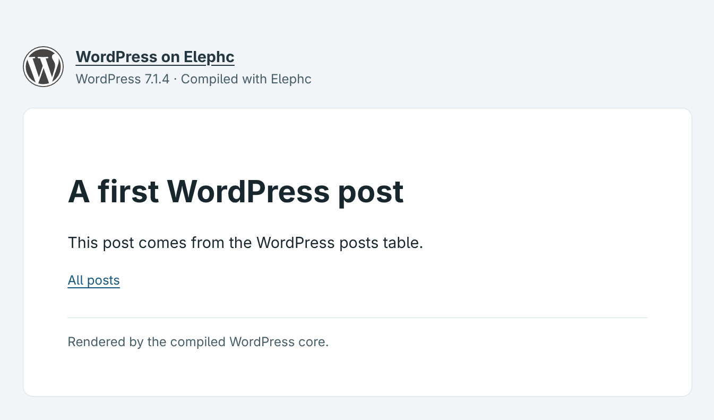

<p align="center">
  <a href="https://github.com/illegalstudio/elephc"></a>
</p>

<p align="center">
  <a href="https://wordpress.org"></a>
</p>

<h1 align="center">WordPress 7 on Elephc</h1>

<p align="center">
  <em>WordPress posts and blocks, rendered by an ahead-of-time compiled core.</em>
</p>

<p align="center">
  <a href="LICENSE"></a>
  <a href="https://x.com/nahime0"></a>
</p>

<p align="center">
  <strong>WordPress 7.1.4 &middot; 1,103 WordPress patches &middot; 15 runtime fixtures &middot; 2 Elephc SDK patches &middot; native web and CLI</strong>
</p>

<p align="center">
  An experimental port that starts from the complete WordPress release and compiles the bootstrap and content renderer with <a href="https://github.com/illegalstudio/elephc">Elephc</a>. The native executable serves a list of SQLite-backed posts and renders each article live.
</p>

<p align="center">
  <a href="https://elephc.dev"><strong>Official Website</strong></a>
</p>

---

> [!IMPORTANT]
> This experiment verifies an isolated bootstrap and content-rendering path. A
> full WordPress site, including theme routing and administration, is outside
> the current profile.



## Current status

- The pinned WordPress 7.1.4 archive contains 3,782 original files, including
  1,512 PHP files. Preparation verifies the complete inventory and applies the
  [patch manifest](patches/full-source/manifest.json), which records original,
  patch and resulting file checksums for each target.
- The native CLI bootstrap registers 116 core blocks and matches the original
  PHP result, including 109 original theme pattern hashes. An independent
  source-only export rebuilt the CLI and repeated the parity checks.
- The HTTP fixture serves `/` and `/index.php` on port 9000. The homepage uses
  Gutenberg's Latest Posts block to list three English demo posts. WordPress
  generates the links as `/?p=<id>` and loads each article from SQLite. All 20
  native HTTP checks passed, including original-PHP parity for the full pages.
- All 47 native control groups passed 230,504 comparisons in each IR mode.
  The [verification snapshot](docs/elephc/full-source-status.json) records the
  compiler, build and test identities.

## Patch and fixture inventory

| Layer | Count | Purpose |
| --- | ---: | --- |
| [WordPress source patches](patches/full-source/README.md) | 1,103 | 639 compatibility rewrites and 464 finite-profile adaptations, each applied to a complete original file |
| [Runtime fixtures](elephc/full-source/fixtures/) | 15 | Local configuration, in-memory SQLite, bootstrap probes and bounded PHP compatibility helpers |
| [Elephc SDK patches](patches/compiler/README.md) | 2 | Compiler and linker-scale adaptations in `wordpress-main.patch`, followed by the request-global storage fix in `wordpress-web.patch` |
| [HTTP entrypoint](elephc/full-source/web.php) | 1 | Application adapter that invokes the bootstrap, seeds three SQL rows and serves the rendered content |

## Estimated WordPress code exercised

The default page exercises approximately **1.8%** of the distributed PHP source
lines on the original-PHP reference path (11,630 of 635,648 lines). Across the
homepage, five test documents and three articles, the estimate is **2.0%**
(12,405 lines), with at least one line reached in 322 of the 1,512 original PHP
files.

The estimate uses PHP 8.5.12's `phpdbg` opcode log for the unmodified WordPress
7.1.4 web fixture through the end of the response. It counts
distinct original file/line pairs with opcode hits, divided by all physical
lines in the archive's PHP files, including comments and blanks. Fixtures and
non-PHP assets are excluded. All nine traced renders matched the PHP baseline.
This is a reference-path estimate for the native fixture. Native verification
compares outputs, while an Elephc line-coverage measurement would require
instrumenting the native executable.

## Reproduce the web build

Run directly on a Linux x86_64 host with the following tools and libraries.

- Python 3.12 or newer, Bash, `patch`, a C compiler/linker and GNU binutils.
  The tested development SDK requires glibc 2.39 or newer.
- LLVM `ld.lld` on `PATH`, or its executable selected with `WORDPRESS_LLD`.
  The build can also discover `rust-lld` through an active `rustc` on `PATH`.
- The libsodium development library and headers available to the linker.
- PHP 8.4 or newer with PDO SQLite and mbstring for the reference checks.
- Internet access for the pinned WordPress archive and locked native packages.

First assemble the complete SDK from Elephc revision
`f20729406216d21ce99841cf4636b771db9874dd` (version `0.27.8`) plus the two SDK
patches. The original CI SDK artifact was unavailable on 2026-11-23. The
[compiler and bridge build recipe](patches/compiler/README.md) shows how to
build the SDK from source. [`toolchain.json`](elephc/full-source/toolchain.json)
records both compiler identities and the 25 runtime archives used in the CLI
and web proofs. A locally rebuilt SDK has its own binary identities and requires
verification.

```bash
export ELEPHC_BIN=/path/to/complete-sdk/elephc
./scripts/build-wordpress.sh --web
./scripts/serve-wordpress.sh
```

The wrapper prepares and checks the complete WordPress tree and installs the
locked native dependencies. It compiles with `--php-version 8.4`, `--web` and
`--web-isolation request`, with IR optimization off and a 512 MiB runtime heap.
Generated sources, reports and binaries go under `elephc/build/full-source/`.
`elephc` on `PATH` also works when it belongs to the complete SDK.

The recorded web build took about 36 minutes and produced a 2.22 GB executable.
Budget about 35 GiB of compiler memory and enough disk space for 17.7 GB of
assembly plus linker intermediates. Cold native dependency setup can add several
minutes.

Open [http://127.0.0.1:9000](http://127.0.0.1:9000). `/` and `/index.php` accept
GET and HEAD. Click an article in the Latest Posts list or open
[the SQLite article](http://127.0.0.1:9000/?p=1003) directly. Rerun the serve
script to start an already-built binary.

Try a different block document without recompiling.

```bash
curl --get --data-urlencode 'document=<!-- wp:paragraph --><p>Hello WordPress</p><!-- /wp:paragraph -->' http://127.0.0.1:9000/
```

The optional document is limited to 16,384 UTF-8 bytes without NUL.

## Compile the CLI bootstrap

```bash
./scripts/build-wordpress.sh
./elephc/build/full-source/bootstrap '<!-- wp:paragraph --><p>Hello</p><!-- /wp:paragraph -->'
```

The CLI prints JSON with the HTML in its `rendered` field. Its executable and
build reports are separate from the web build.

## How the port works

Preparation copies the original archive and applies the full-file patch series
and fixtures in the generated tree. The original checksums remain intact. The
[section-placement linker](scripts/wordpress-link.py) preserves allocated bytes
and distinct function addresses in the large generated program.

```text
Elephc HTTP listener
  -> web.php validates the route, method, post ID or block document
  -> original wp-load.php and wp-settings.php initialize the site
  -> the entry inserts three demo posts into the SQLite fixture
  -> core Latest Posts (WP_Query) or get_post() loads the content
  -> do_blocks() and do_shortcode() render the response
```

The listener uses one worker and a fresh handler process per request. Each
handler runs the core bootstrap and recreates the in-memory SQLite database
before rendering. The diagnostic inspection probes run on the separate CLI
path. The fixture selects Twenty Twenty-Five, English locale and an empty
plugin list. The WordPress mark in the header comes from the pinned archive.

The maintained `WP_Query` and Latest Posts file patches preserve the same
query and block. The former converts rows with a direct `get_post()` call
using its original defaults. The latter passes the live loop post to the
title and permalink APIs.

## Verify

Check the archive and patch integrity, compare the compiled CLI with PHP, and
test HTTP on a separate port.

```bash
python3 scripts/prepare-wordpress.py --check
python3 scripts/test-wordpress-bootstrap.py \
  --native elephc/build/full-source/bootstrap
python3 scripts/test-wordpress-web.py --port 9001
```

The HTTP test follows all three links from the WordPress block and compares the
full native pages with original PHP. It also checks repeated requests, HEAD,
missing articles, rejected methods and invalid inputs. Pass `--reference-only`
to run the original-PHP web checks without a compiled web binary.
For a new SDK, install the locked dependencies before running the control suites.

```bash
"$ELEPHC_BIN" native install --locked --manifest-path elephc/full-source/elephc.toml
python3 scripts/test-wordpress-controls.py --compiler "$ELEPHC_BIN"
ELEPHC_IR_OPT=off python3 scripts/test-wordpress-controls.py --compiler "$ELEPHC_BIN"
python3 scripts/test-wordpress-linker.py
```

Reconstruct the source tree in a temporary export and verify the controls.
Add `--native` for a fresh CLI build and bootstrap parity check.

```bash
python3 scripts/test-wordpress-clean-room.py --compiler "$ELEPHC_BIN"
ELEPHC_IR_OPT=off python3 scripts/test-wordpress-clean-room.py \
  --native --compiler "$ELEPHC_BIN"
```

## Current boundaries

Full theme request routing, administration, authentication, arbitrary plugins,
network operations and a persistent database are outside the verified profile.
Calls to unsupported APIs fail at explicit boundaries, and the control suites
use finite collaborators for paths outside the fixture.

## Documentation

- [Porting log and verified execution](docs/elephc/porting-log.md)
- [Machine-readable verification snapshot](docs/elephc/full-source-status.json)
- [Elephc patches and SDK build recipe](patches/compiler/README.md)
- [WordPress patch format and maintenance](patches/full-source/README.md)
- [Native API boundaries](docs/elephc/native-api-boundaries.md)
- [Original archive version and checksums](elephc/upstream.json)

WordPress sources retain their upstream GPL-2.0-or-later license. See
[`LICENSE`](LICENSE) and the original archive's `license.txt`.
